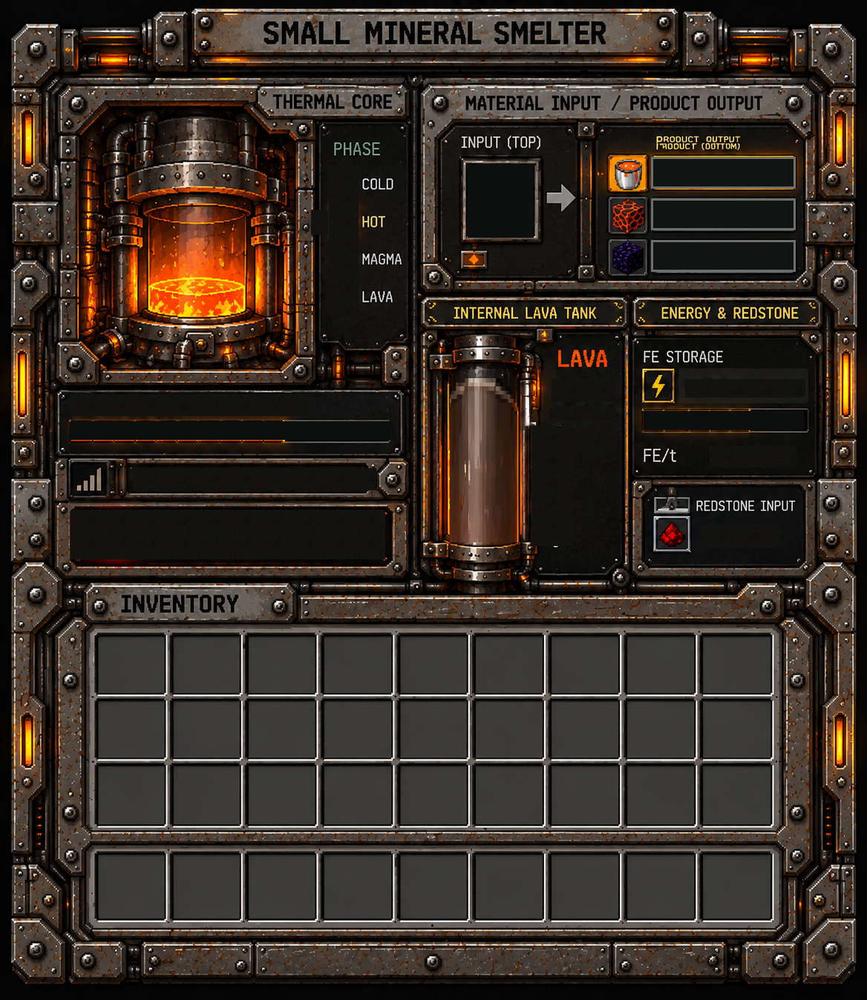
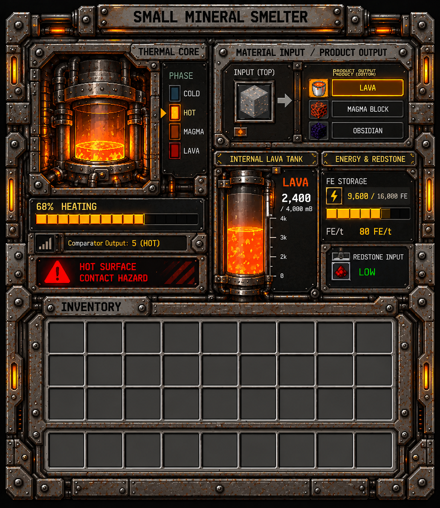
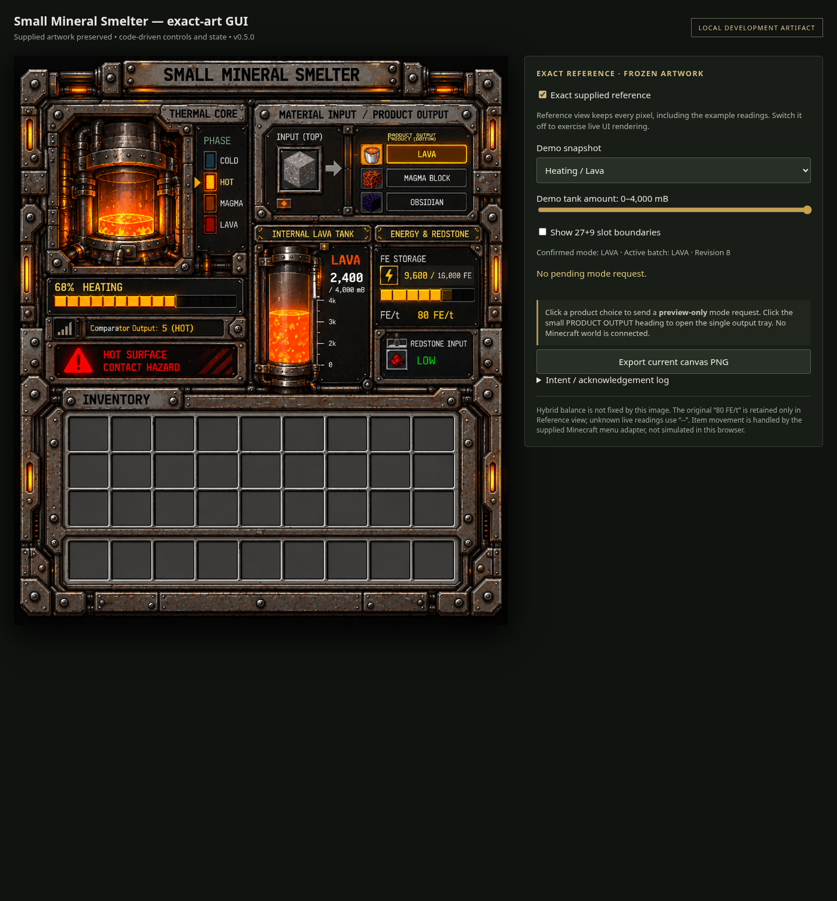
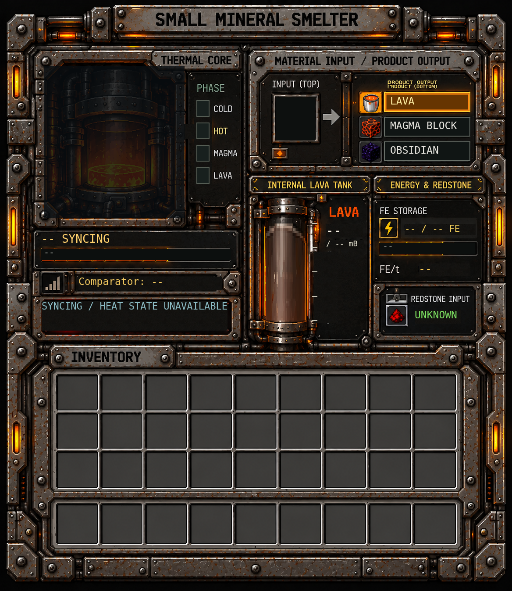
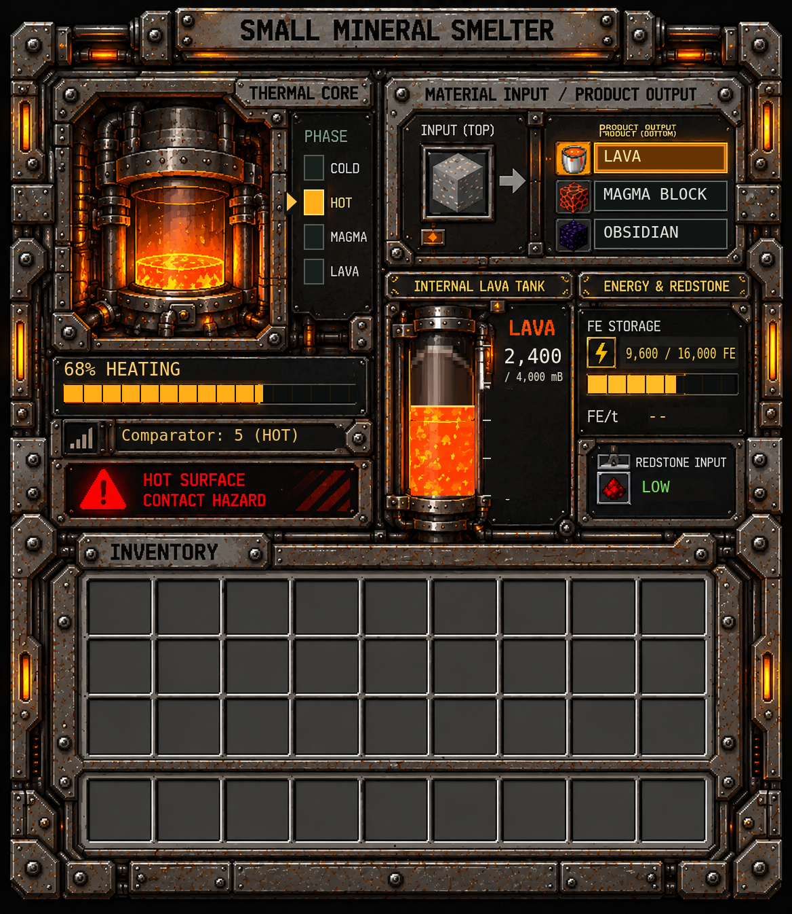
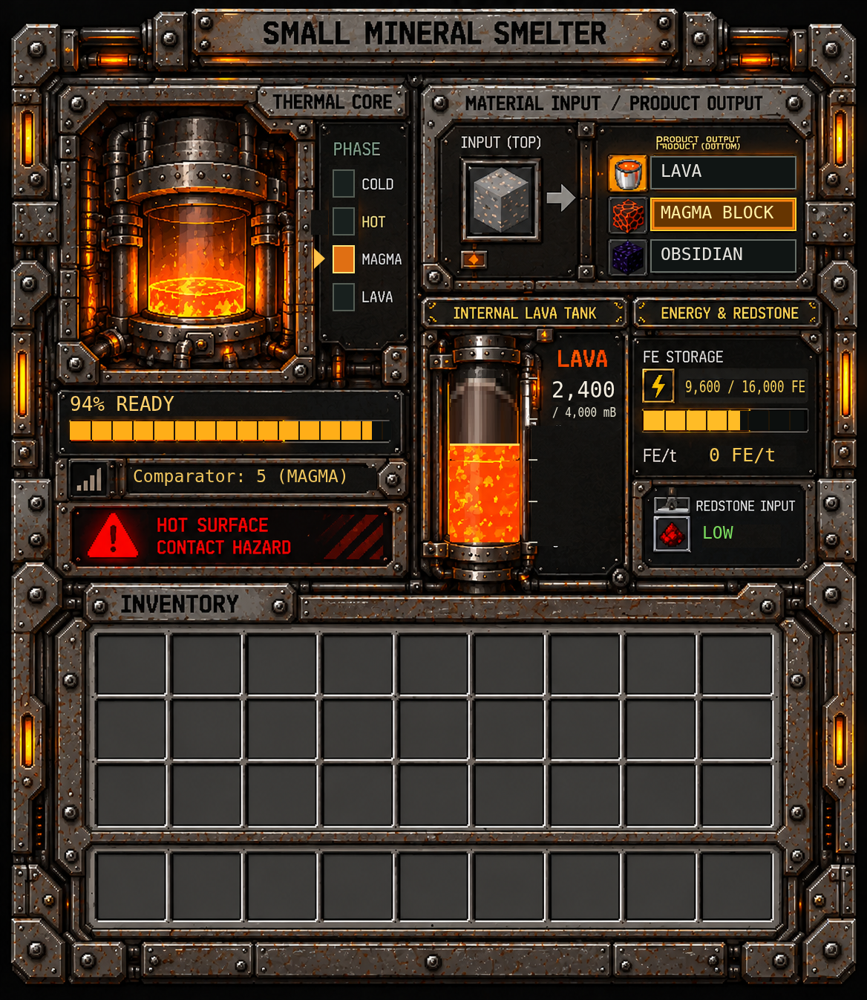
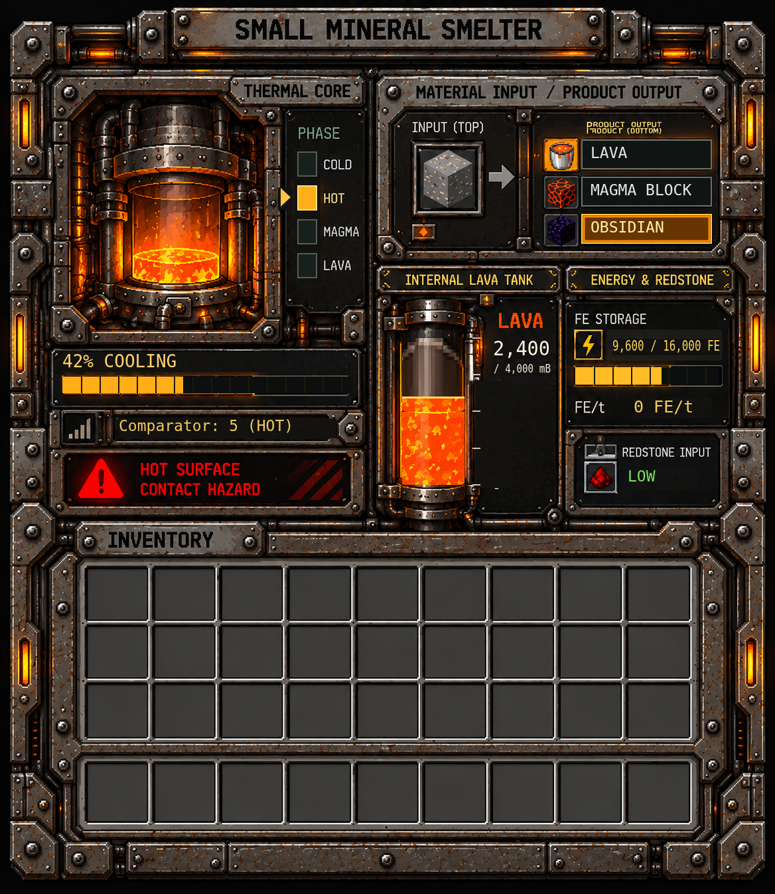
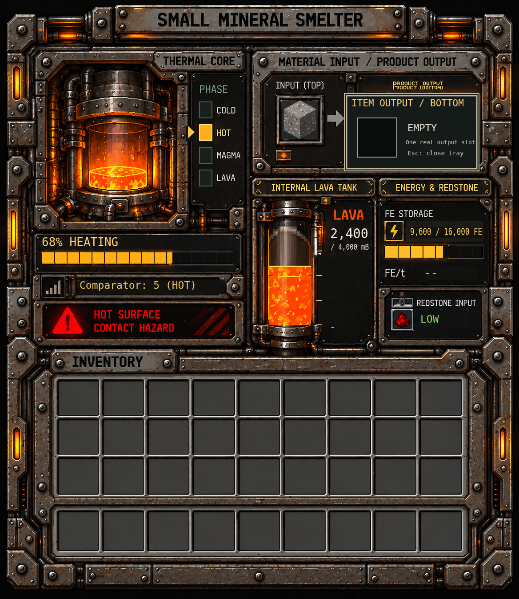

# Small Mineral Smelter v0.5 — visual review

**Pull request:** #133, draft; stacked on the mechanics candidate #132.
**Owner visual approval:** PENDING.
**Minecraft client capture:** NOT PERFORMED.
**Toolkit full-image CLI reproduction:** PENDING.

## Canonical reference PNG

This is the user-supplied frozen reference, 1168×1346, RGBA. Its SHA-256 is `d48c7e0ea4ba0851280813166393678a6f7151f6e1e05d3c51ebd55646b6943d`. The example values in this image are reference data only; the runtime screen reads live values from the server projection.

## Runtime resource used by #133

The runtime uses a separate blank faceplate at [background.png](../../src/main/resources/assets/immersive_engineer_decor_controls_tool_reforged/textures/gui/small_mineral_smelter_hybrid_v05/background.png), 1168×1346 RGBA, SHA-256 `450784a3989897a9241abe6cec891f0432812e55f5a38c84a09b0f2334cda182`. It is drawn on the 234×270 logical menu canvas. Live values are overlaid from the dedicated v0.5 server projection; the frozen reference screenshot is never loaded as the runtime texture.

## Supplied package preview images

The following are supplied bundle previews, not screenshots captured from Minecraft and not renders produced by this PR. They are shown so the owner can review all supplied GUI states before merge.

### Supplied reference rebuild

The bundle-provided rebuild is RGBA pixel-identical to the canonical source (zero differing pixels and zero alpha differences). This comparison does not prove Toolkit CLI output.

### Supplied application preview

### Supplied disconnected-data preview

### Supplied live heating preview

### Supplied live magma preview

### Supplied live cooling preview

### Supplied output-drawer preview

### Supplied browser reference preview

### Supplied restored-reference preview

## Toolkit source files and exact-render gate

The provided JSON files are included under [toolkit-source](small-mineral-smelter-v05-visual-review/toolkit-source/): [layout.json](small-mineral-smelter-v05-visual-review/toolkit-source/layout.json), [widgets.pixelart.json](small-mineral-smelter-v05-visual-review/toolkit-source/widgets.pixelart.json), and [mutable_regions.pixelart.json](small-mineral-smelter-v05-visual-review/toolkit-source/mutable_regions.pixelart.json). They describe layout, widgets and mutable regions; they are not a complete JSON reconstruction of every pixel in the canonical PNG. The supplied package rebuild was compared pixel-for-pixel, but this work did not produce a full-image Toolkit JSON or run the actual Toolkit CLI against such a JSON. **The exact Toolkit JSON → CLI PNG → zero-difference gate remains open and must be completed before merge.**

## Runtime mapping in this candidate

#133 now uses the dedicated 17-field projection: v0.5 fields 0–15 retain their specified meanings; field 16 is the explicit batch-progress extension from the v0.4 mechanics draft. The screen displays selected mode, committed batch and progress, queued mode, thermal phase, exact tank and FE values/capacities, measured FE/t, redstone, comparator, confirmed hazard and stable status. Unknown readings remain “--”/localized unknown values. Mode changes use the dedicated revision-checked server payload.

The code and resource changes have not been compiled or run in Minecraft in this environment. The supplied images above are review references, not evidence of a correct Minecraft render. Owner visual review is still required, and this PR must remain draft until that review and the exact Toolkit render gate are complete.
