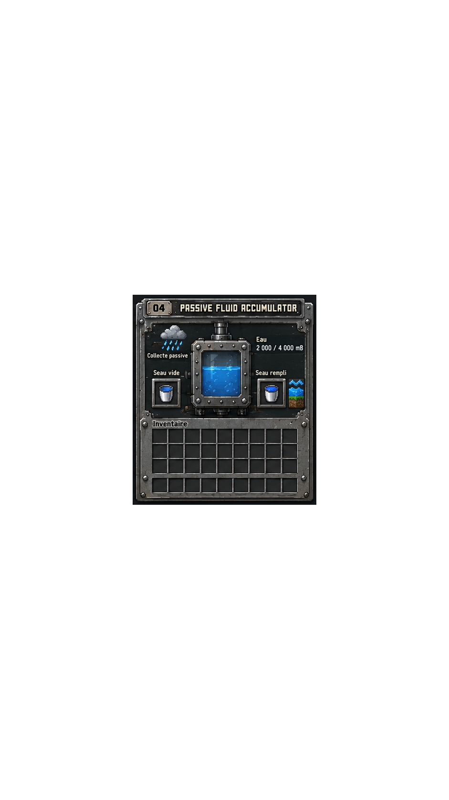

# Passive Fluid Accumulator GUI

## Reference

- Canonical owner-supplied PNG: 941×1672 RGBA; file SHA-256 bb2206d5caf1913081f66b4f22ac9cb2fa5720a0489fd28fc80ab1b96eafc5a7; decoded RGBA SHA-256 384c8f2f6c85bb4372a0761b8dee03cf45f74775be2c00bf56e676213b94612f.
- Visible alpha bounds: (278,616)-(663,1055), producing a 385×439 source crop with RGBA SHA-256 a4c8df73dc5a964871aca16da59bdd62253f154da07fb35a35488e3073fa7b9b.
- No separate artwork license statement accompanied the supplied PNG; provenance is recorded in both root and packaged CREDITS.md without asserting a distinct license.

## Runtime mapping

- The runtime texture is a byte-for-byte copy of the canonical PNG. The client blits source region (278,616,385,439) from the full 941×1672 texture onto a 209×238 logical canvas. Source and destination dimensions remain separate; tests check source bounds and mapping.
- Existing machine behavior and server synchronization are unchanged. MachineMenu already receives exact fluid amount in data field 2 and reports 4000 mB capacity. Only water is supported by the existing accumulator logic.
- Machine item slots remain container indices 0 (empty bucket input) and 1 (filled water bucket output); their positions are fitted to the two illustrated frames. Output behavior is stored separately from the role text, so localized labels cannot change slot validation or shift-click semantics. Player inventory remains 27 slots plus 9 hotbar slots.
- The static sample amount and blue tank fill are covered by the server-backed value and proportional water fill. Bucket illustrations, sample labels, and inventory caption are covered by actual localized labels or the interactive slots. The passive collection/rain artwork remains explanatory and adds no state or mechanic.

## Toolkit proof and visual QA status

| Canonical owner-supplied reference | Pinned Toolkit native render (`--scale 1`) |
| --- | --- |
|  |  |

- Lossless source: [`passive-fluid-accumulator.native-exact.json`](passive-fluid-accumulator.native-exact.json), representing 169,015 visible pixels in 32,608 RGBA colors as Toolkit `pixels` operations. Fully transparent source pixels are `(0,0,0,0)`.
- Verified Toolkit source commit: `98eecf77190d5716820ec659f8aeb790513c8e93`. Commands run from that source tree: `PYTHONPATH=src python -m pixel_art_skill_toolkit validate <json>` and `PYTHONPATH=src python -m pixel_art_skill_toolkit render <json> -o <png> --scale 1`. Validation returned 941x1672 RGBA.
- Owner reference, branch reference copy, runtime texture, and Toolkit render all decode to RGBA SHA-256 `384c8f2f6c85bb4372a0761b8dee03cf45f74775be2c00bf56e676213b94612f`. A direct pixel-by-pixel comparison found 0 differing pixels out of 1,573,352, including alpha. The rendered PNG file SHA-256 is `a47a4a9557073d56d8df0416699db5a529811f3ee57d1474c2d1eb4e63e70566`; its encoded-file hash differs from the source while decoded pixels match.
- The available v0.2 Library candidate remains procedural and non-pixel-identical; it was not used.
- No Minecraft client was launched. This proves native PNG-to-Toolkit fidelity only; runtime UI QA and owner visual approval remain pending. Please review the reference and Toolkit output above and provide visual approval or requested corrections before merge. Neither image is a game screenshot.
