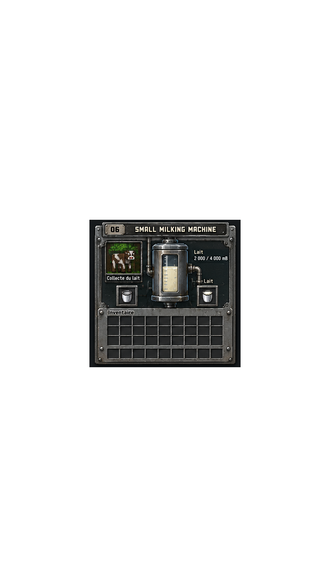

# Small Milking Machine GUI

| Canonical owner-provided reference | Pixel Art Skill Toolkit native render (`--scale 1`) |
| --- | --- |
|  |  |

## Art provenance and exact native proof

- The 941x1672 RGBA PNG was supplied by the repository owner for this integration. It is copied unchanged as the reference and runtime texture. No separate artwork license statement accompanied the file; this records provenance without assigning a new license.
- PNG file SHA-256: `df1120574fd6fdc8561ab54e4be72879aee254e87a366f36778214ea06fa87a9`.
- Decoded RGBA SHA-256: `c815258751b60532d6f189c34d678cacd1b4a17740c6cb9d03904dcfe8a5fbff`.
- Lossless Toolkit source: [`small-milking-machine.native-exact.json`](small-milking-machine.native-exact.json). It preserves every non-transparent color as palette-grouped `pixels` operations; transparent pixels are `(0,0,0,0)`.
- The pinned Toolkit at commit `98eecf77190d5716820ec659f8aeb790513c8e93` validated and rendered the JSON at native scale. Validation reported 941x1672 RGBA. The rendered PNG has decoded RGBA SHA-256 `c815258751b60532d6f189c34d678cacd1b4a17740c6cb9d03904dcfe8a5fbff`; pixel-by-pixel RGBA comparison against the owner reference found 0 differing pixels across 1,573,352 pixels.

## Runtime mapping

- The game uses the unchanged PNG resource and blits source crop `(255,626,431,420)` onto a 216x210 logical screen at half scale. The texture and native Toolkit render are separate from the runtime UI composition.
- Existing container slot 0 remains bucket input and slot 1 remains milk output; 27 player inventory slots and 9 hotbar slots remain active. The layout keeps output semantics in a separate flag, so localized tooltips do not affect menu insertion or shift-click behavior. Existing `MachineMenu` field 2 provides server-synchronized milk amount and capacity remains 4000 mB. No machine behavior or TFC compatibility changed.
- The static sample amount and tank fill are replaced by the synchronized amount and proportional fill. Illustrated buckets are masked by real slots. EN/FR labels and tank/slot tooltips are provided. The cow illustration is decorative and does not indicate a live cow-detection signal; no such menu data is synchronized.

## QA status

- Native PNG-to-Toolkit fidelity is proven above. The runtime UI composition has not been validated in a Minecraft client; no game screenshot is included. Owner visual approval remains pending.
