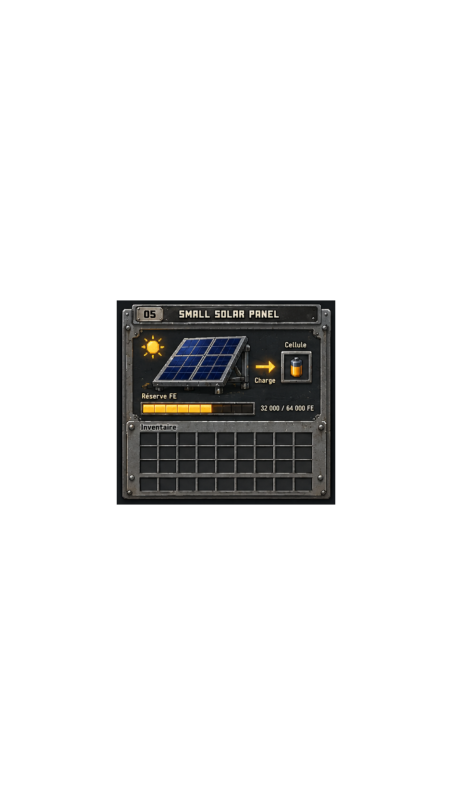

# Small Solar Panel GUI




The first image is a byte-for-byte copy of the user-provided reference. The second is the native scale-1 output rendered from `pixel-art.json`. These are design assets and a Toolkit render, not a Minecraft in-game capture.

## Runtime data and behavior

The existing machine menu still owns the live Cell slot at index 0 and the 64,000 FE capacity. The runtime meter and FE readout use the synchronized menu value; the reference’s illustrative `32 000 / 64 000 FE` text is not used as a fixed runtime value. Hovering the meter shows the live stored/capacity values and states that the server menu value is synchronized in 100 FE steps. Charging, extraction, inventory placement, and comparator behavior are unchanged.

## Exact pixel reproduction

The source PNG was kept unchanged. The Toolkit document has a 941×1672 transparent canvas. It encodes the source’s nontransparent pixels using the Toolkit `pixels` operation and a color palette.

Toolkit: `emmanueltremblay9-stack/pixel-art-skill-toolkit` at commit `98eecf77190d5716820ec659f8aeb790513c8e93`. The local CLI modules used for this run were fetched from that exact commit; their Git blob IDs were verified:

- `__init__.py`: `0c61e69d67f09922a3280afcbe5edd24d6949965`
- `__main__.py`: `2efe692355a2fab5977172d38f236f8106ba9b3f`
- `cli.py`: `91e98b62603b164f616ebeaff59204f521c04e3b`
- `format.py`: `5c1642a83bf7a918384f6c004587f00e18668e43`
- `renderer.py`: `a022505fab700c014456e157318f398c05970dad`

From the repository root, with `PYTHONPATH` pointed at the Toolkit checkout’s `src` directory:

```powershell
python scripts/generate_exact_pixel_art_json.py docs/gui/small-solar-panel/reference.png docs/gui/small-solar-panel/pixel-art.json
python -m pixel_art_skill_toolkit validate docs/gui/small-solar-panel/pixel-art.json
python -m pixel_art_skill_toolkit render docs/gui/small-solar-panel/pixel-art.json --scale 1 --output docs/gui/small-solar-panel/toolkit-render.png
python scripts/verify_exact_pixel_art.py docs/gui/small-solar-panel/reference.png docs/gui/small-solar-panel/toolkit-render.png --report docs/gui/small-solar-panel/pixel-match.txt
```

The Toolkit CLI reported `941×1672 RGBA`. Native RGBA comparison reports **0 differing pixels**.

| File | SHA-256 |
|---|---|
| Reference PNG | `6C84213F58FC30E13EB2AC9A9F51853AD65EAB09001D886C7850DE3B9BBB297E` |
| Toolkit JSON | `AA78E9EE887FA46C412091BCB2321B1B9FD4FF7C747EE60BC9A5E96FDC94C6D0` |
| Toolkit render PNG | `549EE41995F32F1811389F11718358372294F67C1F5886ED9ADD0E3DC0F4308C` |

Please inspect the reference/render and the runtime GUI visually before merging this draft. The runtime GUI has not been captured in-game.

