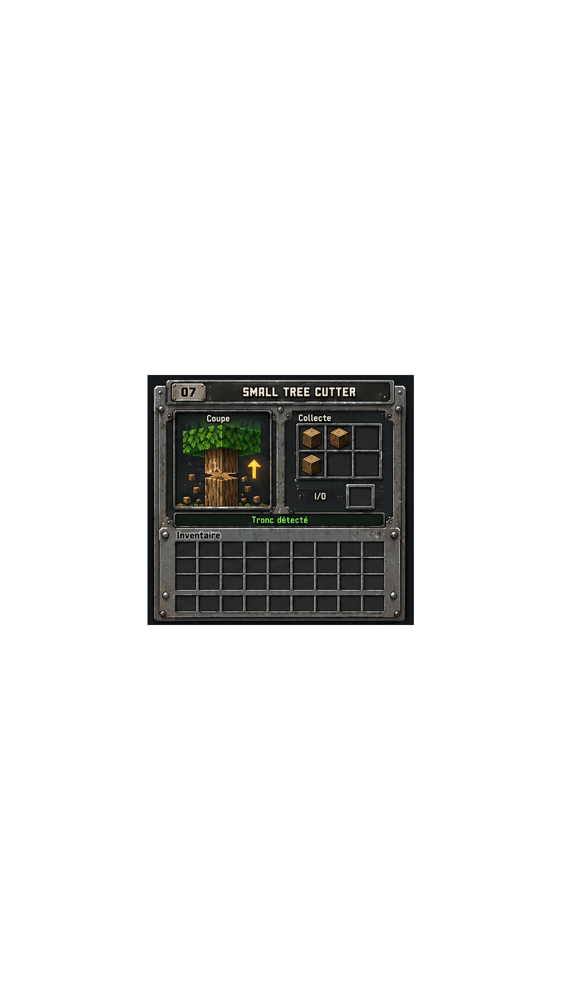

# Small Tree Cutter GUI




The first image is a byte-for-byte copy of the user-provided reference. The second is the native scale-1 output rendered from `pixel-art.json`. These are design assets and a Toolkit render, not a Minecraft in-game capture.

## Runtime slots and state

The reference art depicts six collection cells (3×2), two sample logs, and a “Tronc détecté” label. The runtime menu contract exposes nine real Drops slots at indices 0–8 in a 3×3 grid plus the I/O slot at index 9. All ten slots and their server-backed item interactions remain available; sample logs and the tree-detected label are not displayed as live state. The existing comparator readout remains server-backed. The generic work-progress arrow is omitted because this machine does not synchronize a work-progress value.

This is an intentional runtime adaptation to preserve the actual inventory contract. It does not alter storage, slot indices, automation, or tree-cutting behavior. The displayed 3×3 Drops grid is runtime layout; the exact reference JSON remains unchanged.

## Exact pixel reproduction

The source PNG was kept unchanged. The Toolkit document has a 941×1672 transparent canvas. It encodes the source’s nontransparent pixels using the Toolkit `pixels` operation and a color palette.

Toolkit: `emmanueltremblay9-stack/pixel-art-skill-toolkit` at commit `98eecf77190d5716820ec659f8aeb790513c8e93`. The local CLI modules used for this run were fetched from that exact commit; their Git blob IDs were verified:

- `__init__.py`: `0c61e69d67f09922a3280afcbe5edd24d6949965`
- `__main__.py`: `2efe692355a2fab5977172d38f236f8106ba9b3f`
- `cli.py`: `91e98b62603b164f616ebeaff59204f521c04e3b`
- `format.py`: `5c1642a83bf7a918384f6c004587f00e18668e43`
- `renderer.py`: `a022505fab700c014456e157318f398c05970dad`

From the repository root, with `PYTHONPATH` pointed at the Toolkit checkout’s `src` directory:

```powershell
python scripts/generate_exact_pixel_art_json.py docs/gui/small-tree-cutter/reference.png docs/gui/small-tree-cutter/pixel-art.json
python -m pixel_art_skill_toolkit validate docs/gui/small-tree-cutter/pixel-art.json
python -m pixel_art_skill_toolkit render docs/gui/small-tree-cutter/pixel-art.json --scale 1 --output docs/gui/small-tree-cutter/toolkit-render.png
python scripts/verify_exact_pixel_art.py docs/gui/small-tree-cutter/reference.png docs/gui/small-tree-cutter/toolkit-render.png --report docs/gui/small-tree-cutter/pixel-match.txt
```

The Toolkit CLI reported `941×1672 RGBA`. Native RGBA comparison reports **0 differing pixels**.

| File | SHA-256 |
|---|---|
| Reference PNG | `CF7B45660F48049F2631EC1B19578D9E3842B0AA32490112D15E93397ADF53EB` |
| Toolkit JSON | `95BB04D98B88CE2074163D345B0D032B06C732F4ABD9239B6FA236A23227599A` |
| Toolkit render PNG | `A72019F695FD2F16B6F8DBE249C7351C7344737C41C766E47F072318F76E0E9F` |

Please inspect the reference/render and the runtime GUI visually before merging this draft. The runtime GUI has not been captured in-game.

