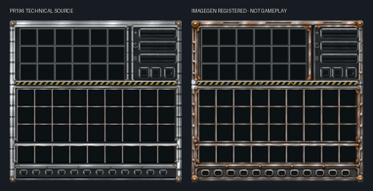
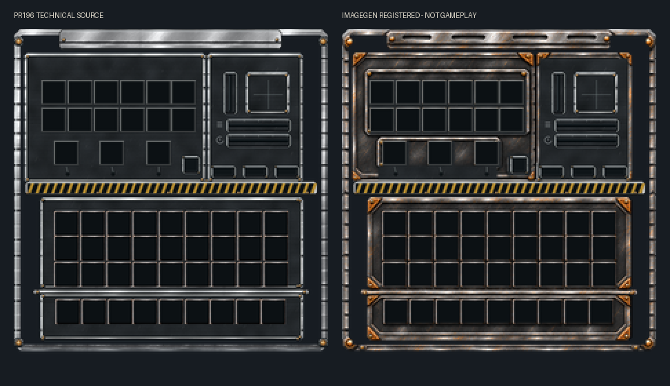

# Registered Factory Hopper and Factory Dropper candidate

Status: proposed, not owner approved, not native-qualified. No merge or release is implied.

Both backgrounds use the owner's industrial frame direction: machined steel, copper structural accents, bevels and corner reinforcement. Generated material studies were registered piecewise onto the existing machine geometry. They were not pasted directly or globally resized as final textures. Earlier vector-only studies were retained separately but not shipped in this candidate.

## Reproducible source

The review bundle `factory_gui_imagegen_registered_candidate.zip` has SHA-256 `03a581d48e3b484947749c134feb610cdda2cb88af9d83e00d1c6ad682920d35`. It contains raw generation outputs, source PNGs, SVG registration patches and anchor tables, editable ORA layers, reconstruction scripts, provenance, static tests and before/after comparisons. Technical restoration uses original PR196 commit `c3a2fd55e290a1102e885b3b30972cf41f6cf0d4` PNGs, not the intermediate R03 repaint or an image-upload round trip. Hashes of the integrated PNGs are recorded in provenance.json.

## Static guarantees and boundaries

`protected-regions-r04.json` pins the original functional-region and alpha digests. The guard checks 79 Hopper and 65 Dropper regions: 105 item footprints, 14 controls, native readout/status/identity regions, and all 18 Hopper selection positions at the corrected pitch. Dimensions remain 1056x996 and 1368x1500 (six texels/logical pixel). This preserves pixels and geometry, not proof of interaction or runtime rendering.

Source edit: Hopper selection outline used row pitch 17 while the unchanged menu uses 18. The outline now follows 18, yielding y 8/26/44 around item y 9/27/45. A source regression test reads MachineLayout itself, checks all 18 positions at two origins, rejects the old pitch and pins the unchanged Placer method. No menus, action IDs, hitboxes, stored data or mechanics changed.

FactorySteelFrame still paints native slot rims after the background; native widget state and symbols remain runtime-owned. Fresh exact-commit/JAR captures must assess those overlays, filled slots, selection on all three rows, scale, tooltips, state changes and compatibility. Historical CI, JAR hashes and screenshots are not transferred to this candidate. Local static successes do not establish a Minecraft visual or input pass.

Before publication: confirm native/current-head CI and owner visual acceptance, plus source rights. Do not mark ready, merge or publish on the strength of this document.

## Static comparisons, not Minecraft captures

Left: exact PR196 source. Right: registered candidate at the same 2x logical scale.

